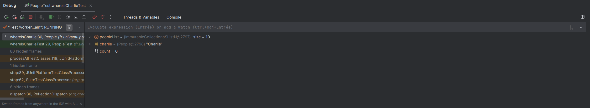

Ce fichier donnes les instructions pour le TD2. Il est au format markdown, permettant d'éditer 
du texte avec des instructions de formattage simples. Pour le lire, il est préférable d'activer 
la visualisation du document formatté, sous VS Code avec le raccourci clavier `Control Shift V`.

Introduction
============

Dans les exercices suivants, chaque petit programme comporte une 
erreur, qui apparait lors du test. L'objectif est d'apprendre à utiliser le débugueur 
pour Java pour trouver la cause de l'erreur, et la corriger.

La tâche Gradle `td2Test` permet de lancer les tests, mais on préfèrera cette fois 
lancer uniquement le test de l'exercice en cours. Avec gradle, on utilisera la commande
`./gradlew test --tests fr.univamu.progav.td.td2.ASimpleLoopTest.java` par exemple. Par 
contre cela ne permet pas de lancer le débugueur.

L'intégralité des tests de ce TD peut être évaluée avec la commande `./gradlew td2Test`.

Exécuter un test depuis l'IDE
-----------------------------

Les consignes ci-dessous supposent l'utilisation de Visual Studio Code. Les autres IDE 
pour Java ont les mêmes fonctionnalités, mais les boutons ne seront pas au même endroit. 

Pour lancer un test ou un programme en mode débugueur depuis VS Code, ouvrir le 
fichier contenant le test ou le point d'entrée du programme, puis
- pour une méthode de test, dans la marge de cette méthode, 
`clic gauche` sur l'icône de lancement , et choisir l'option *debug test*.
- pour un point d'entrée `main`, `clic gauche` sur le nom du fichier contenant le `main` dans le panneau Explorer, choisir `Debug Java`.

Pour arrêter le débugger à une instruction spécifique du programme, il faut au
 préalable placer des *breakpoints* . Il suffit 
pour cela d'un `clic gauche` dans la marge du programme, sur le numéro de 
ligne. Un `clic droit` permet de le paramétrer si nécessaire, et un deuxième 
`clic gauche` le fait disparaître.

Lorsque le programme s'exécute, il s'interrompt automatiquement aux 
breakpoints, et affiche l'état de la pile dans le panneau de débugage dans la partie 
gauche de la fenêtre, affichable en cliquant sur l'icone .

Description du panneau de débugage
-----------------------------------



Dans la partie basse se trouve la pile d'appel (*call stack*), c'est-à-dire des niveaux ou couches de la pile, 
la plus récente en haut. Chaque niveau (*frame*) correspond à une méthode dont l'exécution est en cours ou en attente.
Le *frame* est nommé selon l'identifiant de la méthode.
Attention, lancer un test demande un grand nombre d'appels de méthode avant d'arriver à la 
méthode de test, donc la plupart des *frames* ne sont pas pertinents, seuls 
les frames les plus hauts, pour lesquels on reconnaît les méthodes du projet,
nous intéressent.

La partie haute affiche le contenu du frame sélectionné (par défaut, celui 
de la méthode en train d'être exécutée), en commençant par la 
valeur de `this` (si la méthode n'est pas statique), puis toutes les 
variables et leurs valeurs. Les tableaux et les objets peuvent être 
inspectés en dépliant les arborescences (ce qui permet d'inspecter le tas).


Description des actions du débugueur
------------------------------------

La barre du haut  contient les actions réalisables, dont voici les plus 
importantes.

 relance le test depuis le 
début, toujours en mode *debug*.

 arrête l'évaluation du 
programme immédiatement, et ferme le débuggeur.

 reprend l'évaluation, 
jusqu'au prochain *breakpoint* ou la fin normale de l'exécution du programme.

 passe à l'instruction 
suivante, en ignorant tout appel de méthodes dans l'instruction en cours. On reste 
donc dans la même méthode, ou pour l'instruction `return` on revient vers la méthode appelante.

 passe à la première 
instruction d'une méthode appelée dans l'instruction en cours. Si 
l'instruction comporte plusieurs appels de méthodes ou constructeurs, 
on rentre dans la prochaine méthode appelée; il est donc parfois nécessaire 
d'entrer plusieurs fois depuis la même instruction.

 reprend l'exécution jusqu'à 
terminer la méthode actuellement en cours (au `return`), et s'interrompt à l'instruction 
ayant appelé la méthode.

Ces actions permettent d'exécuter le programme pas-à-pas, plus ou moins 
finement, en inspectant les valeurs des variables. 


Exercice 1
==========

Ce petit exercice vous permet de prendre en main le débugueur de VS Code.

- Vérifier que la méthode exécutable `main` de la classe `Main` (fichier 
`fr.univamu.progav.Main.java`) appelle bien la méthode `exoDebug` d'une instance de la classe `DebuggerTutorial` (sinon appeler l'enseignant).
- Exécuter le programme (avec `./gradlew run`). Le programme doit afficher :
```
In method f.
In method g.
The end.
```
- Placer un *breakpoint* sur la première 
  ligne de la méthode `exoDebug` (comment ? lire l'introduction ci-dessus). 
  Relancer le programme en mode debug (ouvrir le panneau de débugage 
   à gauche, et tout en haut 
  cliquer sur l'icône  
  après avoir choisi `Main` dans le menu déroulant). 
- Inspecter l'objet `this`. Quelles sont ses propriétés et leurs valeurs ? 
  Ceci correspond-il bien au programme écrit ?
- Avancer l'exécution d'une instruction 
  . Quel est l'effet de 
  l'instruction ? 
- Entrer dans l'exécution de la méthode `f`
  . Combien la pile 
  a-t-elle de couches ? Quelles sont les valeurs de la variable `x` dans les 
  différentes couches de la pile ?
- Ressortir de la méthode `f`
  . Exécuter l'instruction 
  créant une instance de la classe `A` et vérifier son effet sur la mémoire. 
  Quelle est la référence du nouvel objet ?
- Sauter l'appel de la méthode `g`
  .
- Ajouter un breakpoint après la boucle, puis reprendre l'exécution du 
  programme .
- Continuer jusqu'à voir le message de victoire dans le débugueur. Sinon 
  recommencer.


Exercice 2
==========

Dans la classe `People`, la méthode `whereIsCharlie` devrait retourner la 
position de Charlie, 25 ans, dans la liste. Utiliser le test et le débugueur 
pour trouver l'erreur.

Exercice 3
==========

Dans la classe `ASimpleLoop`, la méthode `nonTerminatingSum` fait un calcul, 
qui ne termine pas. Utiliser le test et le débugueur, pour comprendre 
pourquoi elle ne termine pas. Corriger ensuite la méthode pour que le calcul 
s'arrête,

Exercice 4
==========

Dans la classe `Ratio`, représentant les nombres rationnels, l'addition ne 
semble pas produire le bon résultat. Pourtant, nous avons pris soin de bien 
réduire les fractions en calculant le plus grand commun diviseur avec 
l'algorithme d'Euclide, et de forcer cette réduction dans la méthode 
statique `of` que nous utilisons pour construire les fractions. Pour être 
sûr de bien tester, nous avons aussi ajouter une méthode `unsafeOf`, qui 
ignore l'étape de réduction : ainsi les valeurs attendues dans les tests 
sont certainement bien définies (nous les avons réduites nous-mêmes). Enfin, 
la méthode de test d'égalité profite de la forme réduite : il suffit de 
tester l'égalité des numérateurs et des dénominateurs. Utiliser la méthode 
de test et le débugueur pour trouver l'erreur et la corriger. 


Exercice 5
==========

La classe `GuessingGame` reprend la stratégie optimale pour le jeu 
consistant à trouver un entier d'un intervalle (par exemple entre 1 et 1000),
en tentant des valeurs, et en obtenant pour chaque mauvaise réponse une 
indication "plus petit" ou "plus grand". Bien sûr, il s'agit de faire une 
recherche dichotomique. Ici, une erreur a été faite, et la dichotomie ne 
termine pas toujours. Il va d'abord falloir trouver une valeur mystère pour 
laquelle l'algorithme boucle infiniment (provoquant un dépassement de pile). 
Ensuite, en utilisant le débugueur et en partant avec cette valeur, il sera 
possible de repérer la raison pour laquelle l'algorithme boucle ainsi. 
Utiliser donc une fois de plus le débugueur pour trouver et corriger l'erreur.